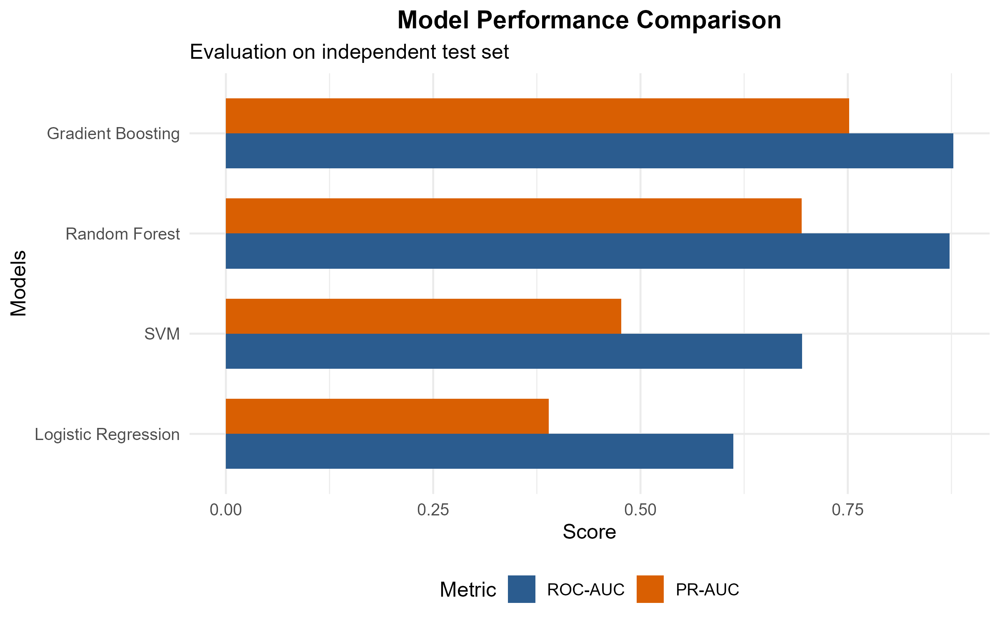
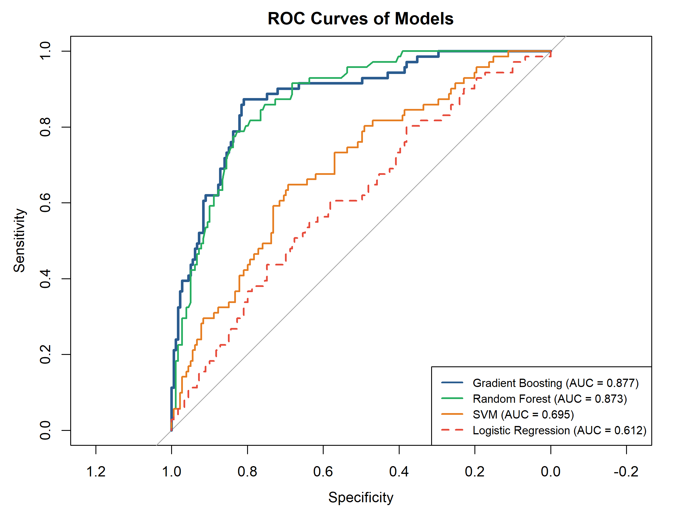
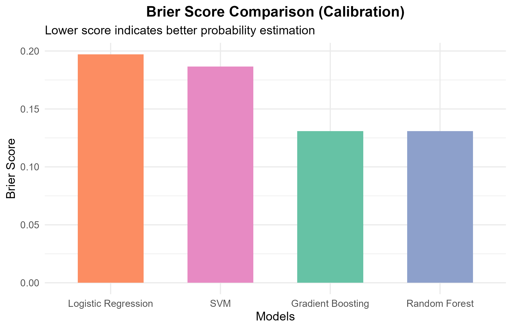
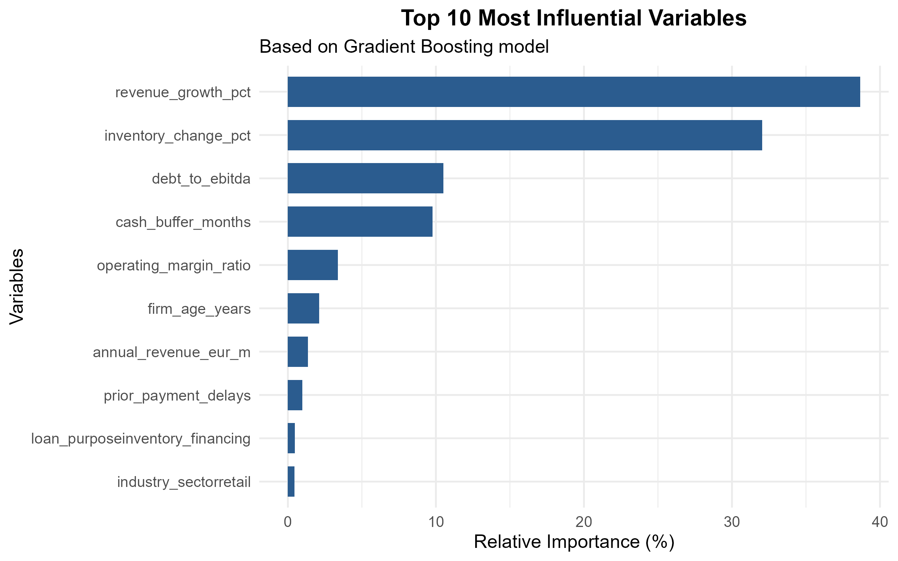

# SME Credit Default Prediction

> Predicting whether a small or medium-sized enterprise (SME) will default on its loan within 12 months, and comparing four machine-learning models in R with a common `caret` protocol.


---

## Table of Contents

- [Overview](#overview)
- [Key Findings](#key-findings)
- [Detailed Results](#detailed-results)
- [Why the Linear Model Fails: an Interaction Effect](#why-the-linear-model-fails-an-interaction-effect)
- [Practical Recommendation](#practical-recommendation)
- [Dataset](#dataset)
- [Code Walkthrough](#code-walkthrough)
- [Repository Structure](#repository-structure)
- [Getting Started](#getting-started)
- [Technical Remarks and Limitations](#technical-remarks-and-limitations)
- [Next Steps](#next-steps)
- [The Report](#the-report)
- [Author](#author)
- [License](#license)

---

## Overview

Accurate default prediction is central to credit risk management: it supports **loan approval**, **risk-based pricing** and **portfolio monitoring**. This project builds a complete modelling pipeline in R that estimates whether an SME will default within the next 12 months (`default_12m`).

Four models are compared on the same data and with the same evaluation protocol:

| Model | Role |
|---|---|
| Logistic Regression | Interpretable baseline |
| Random Forest | Bagged tree ensemble |
| Gradient Boosting (`gbm`) | Boosted tree ensemble |
| Support Vector Machine (RBF kernel) | Kernel-based classifier |

The workflow is: data import and preparation, a stratified **75% / 25%** train/test split, **5-fold cross-validated** training with `caret`, evaluation on a held-out test set, and creation of four figures. Models are assessed with three complementary metrics:

- **ROC-AUC**: how well the model ranks defaulters above non-defaulters.
- **PR-AUC**: performance on the minority class of defaulters; more demanding than ROC-AUC when classes are imbalanced.
- **Brier score**: quality of the predicted probabilities (lower is better).

---

## Key Findings

Results on the independent test set (see the [report](report/SME_Credit_Risk_Report.docx)):

| Model | ROC-AUC | PR-AUC (approx.) | Brier (approx.) |
|---|:---:|:---:|:---:|
| **Gradient Boosting** | **0.877** | **0.75** | **0.131** |
| Random Forest | 0.873 | 0.69 | 0.131 |
| SVM (RBF) | 0.695 | 0.47 | 0.186 |
| Logistic Regression | 0.612 | 0.39 | 0.197 |

- **Best model:** Gradient Boosting, closely followed by Random Forest.
- **Reliable probabilities:** the tree ensembles are also much better calibrated than the SVM and the logistic regression.
- **Key drivers:** revenue growth and inventory change drive the predictions, followed by leverage (`debt_to_ebitda`) and liquidity (`cash_buffer_months`).
- **Reason for the gap:** the main signal is a non-linear **interaction** between revenue growth and inventory change, which a standard logistic regression cannot capture.

> ROC-AUC values are exact (from the figure legend). PR-AUC and Brier values were read from the charts and are approximate.

---

## Detailed Results

All results are computed on the independent test set, which was not used for training or tuning.

### Model performance comparison

<p align="center">
  
  <br><em>ROC-AUC and PR-AUC of the four models on the test set.</em>
</p>

Gradient Boosting is first on both metrics (ROC-AUC 0.877, PR-AUC about 0.75). Random Forest is very close in ROC-AUC (0.873) but lower in PR-AUC (about 0.69). The SVM reaches 0.695 and about 0.47, and the logistic regression is the weakest (0.612 and about 0.39).

PR-AUC should be read against the default rate of **28.4%**, which is the PR-AUC of a random classifier. The tree-based models are far above chance, while the logistic regression is only moderately above it.

### ROC curves

<p align="center">
  
  <br><em>ROC curves of the four models on the test set.</em>
</p>

The Gradient Boosting (dark blue) and Random Forest (green) curves rise quickly toward the upper-left corner and stay close to each other: they detect about **85% of defaulters at a false positive rate of around 25%**. Gradient Boosting is slightly higher in the low false-positive region, which matters most for a lender who wants to avoid rejecting good clients.

The SVM curve (orange) is clearly lower, and the logistic regression curve (red, dashed) stays close to the random-guess diagonal over a large part of the range. These two models have only limited ability to separate defaulters from non-defaulters on this dataset.

### Calibration: Brier scores

<p align="center">
  
  <br><em>Brier score of each model (lower is better).</em>
</p>

The Brier score measures the quality of the predicted probabilities, not only the ranking. A naive model that always predicts the 28.4% default rate scores about **0.203** (0.284 × 0.716).

- The logistic regression (0.197) is barely better than this naive forecast, and the SVM (0.186) improves on it only slightly.
- Gradient Boosting and Random Forest (about 0.131) **reduce the error by roughly one third**, so their probabilities can be used more reliably for pricing or provisioning.

### Variable importance

<p align="center">
  
  <br><em>Top 10 most influential variables (Gradient Boosting, relative influence in %).</em>
</p>

| Variable | Relative importance |
|---|:---:|
| `revenue_growth_pct` | ~39% |
| `inventory_change_pct` | ~32% |
| `debt_to_ebitda` | ~10% |
| `cash_buffer_months` | ~10% |
| All others (`operating_margin_ratio`, `firm_age_years`, `annual_revenue_eur_m`, `prior_payment_delays`, inventory-financing and retail dummies, ...) | each < 4% |

Two variables dominate and together account for more than **70%** of the total. Categorical variables such as sector or loan purpose show some default-rate differences, but the model finds its strongest signal in the dynamics of revenue and inventory, then in leverage and liquidity. Importance shows how much a variable is used by the model; it does **not** indicate the direction of the effect.

Variable names such as `loan_purposeinventory_financing` appear because `caret` automatically converts categorical variables into dummy variables.

---

## Why the Linear Model Fails: an Interaction Effect

A striking result is the large gap between the tree-based models (AUC about 0.87) and the logistic regression (0.61). A supplementary check on the full dataset explains it. Individually, `revenue_growth_pct` and `inventory_change_pct` are almost uncorrelated with default (correlations of **0.013** and **-0.029**), so a linear model finds no signal. Their **combination**, however, is very informative. Splitting each variable at its median gives four groups with very different default rates:

| Revenue growth / Inventory change | Firms | Default rate |
|---|:---:|:---:|
| Low / Low | 246 | 9.3% |
| Low / High | 254 | 46.9% |
| High / Low | 255 | 49.0% |
| High / High | 245 | 6.9% |

Firms where the two variables move in the **same direction** rarely default (about 7% to 9%). Firms where they move in **opposite directions** default about half of the time. Economically, revenue growing while inventory shrinks, or revenue falling while inventory builds up, can signal stress such as unsold stock or overtrading.

This is an **XOR-type interaction**: no straight line in the log-odds can capture it, but decision trees find it naturally. A logistic regression that includes the term `revenue_growth_pct:inventory_change_pct` should therefore perform much better than the plain version.

---

## Practical Recommendation

- **Scoring model:** Gradient Boosting is recommended for deployment.
- **If transparency is required** by regulators or credit committees: a logistic regression including the interaction term, or a small set of interaction-based risk bands, could be a more explainable alternative, provided its performance is checked with the same protocol.

---

## Dataset

| Property | Value |
|---|---|
| Observations | 1,000 SMEs |
| Variables | 20 predictors + 1 target |
| Target | `default_12m` (1 = default within 12 months, 0 = no default) |
| Class balance | 716 non-defaults / 284 defaults (**28.4%** default rate) |
| Missing values | None |

**Predictors**

| Group | Variables |
|---|---|
| Numerical (financial) | `revenue_growth_pct`, `inventory_change_pct`, `debt_to_ebitda`, `cash_buffer_months`, `operating_margin_ratio`, `annual_revenue_eur_m`, `employee_count`, `firm_age_years` |
| Binary indicators | `prior_payment_delays`, `revolving_credit`, `personal_guarantees`, `export_activity`, `ecommerce_presence`, `iso_certification`, `audited_financials` |
| Categorical | `loan_purpose` (4 levels), `industry_sector` (5), `geographic_area` (4), `legal_form` (4), `application_channel` (3) |

---

## Code Walkthrough

The whole project is a single R script, [`scripts/sme_credit_risk.R`](scripts/sme_credit_risk.R), built on the `caret` package, which gives the four models exactly the same training and evaluation protocol. A fixed seed, `set.seed(42)`, makes the split and every model training reproducible.

### 1. Packages

| Package | Role in the project |
|---|---|
| `caret` | Stratified split (`createDataPartition`), cross-validation and training (`train`, `trainControl`) of all four models |
| `randomForest` | Random Forest engine used by `caret` (`method = "rf"`) |
| `e1071` / `kernlab` | SVM with radial kernel (`method = "svmRadial"`) |
| `gbm` | Gradient Boosting engine used by `caret` (`method = "gbm"`) |
| `pROC` | ROC curves and ROC-AUC |
| `PRROC` | Area under the precision-recall curve (`pr.curve`) |
| `ggplot2`, `reshape2` | Bar charts; `melt` reshapes the results table for the grouped bar chart |
| `readxl`, `xgboost` | Loaded in the script but **not used** |

### 2. Data preparation

The CSV is read with `read.csv`. The target `default_12m` is converted to a factor with the valid level names **"No"** (0) and **"Yes"** (1), which `caret` requires when class probabilities are requested. The five text columns (`loan_purpose`, `industry_sector`, `geographic_area`, `legal_form`, `application_channel`) are converted to factors.

### 3. Train/test split and cross-validation

- **Split:** 75% training / 25% testing with `createDataPartition`, which is stratified on the target so both sets keep the same default rate (about 750 training firms and 250 test firms). The test set is used **only once**, for the final evaluation.
- **Protocol:** a shared `trainControl` object defines 5-fold cross-validation on the training set, with class probabilities and `twoClassSummary` (ROC-AUC, sensitivity, specificity). **ROC-AUC is the metric used to select hyperparameters.**

### 4. Model training

All four models use the same formula (`default_12m ~ .`), the same training data, the same control object and `metric = "ROC"`. Each call is preceded by `set.seed(42)` so that the cross-validation folds are comparable.

| Model | `caret` method | Tuning |
|---|---|---|
| Logistic Regression | `glm` (binomial) | None; linear in the log-odds, so it cannot capture interactions or non-linear effects unless added by hand |
| Random Forest | `rf` | `tuneLength = 3`: three values of `mtry` (variables tried at each split) |
| SVM | `svmRadial` | `tuneLength = 3`: three values of cost; kernel width estimated automatically; `preProcess = c("center", "scale")` standardises predictors **inside each CV fold**, which avoids data leakage |
| Gradient Boosting | `gbm` | `caret` default grid (several numbers of trees and tree depths) |

### 5. Evaluation on the test set

The four trained models are stored in a named list and evaluated in a loop. For each model the script predicts the probability of class "Yes", converts the true labels to 0/1 and computes ROC-AUC (`pROC`), PR-AUC (`PRROC`) and the Brier score (mean squared difference between predicted probability and outcome). The results table is printed in decreasing order of ROC-AUC.

### 6. Figures

Four PNG files are saved in `figures/`, which the script creates if needed:

| File | Content |
|---|---|
| `1_metrics_comparison.png` | ROC-AUC and PR-AUC as horizontal grouped bars (`melt` + `ggplot2`) |
| `2_roc_curves.png` | ROC curves: Gradient Boosting first with `plot`, the other three added with `lines` |
| `3_brier_scores.png` | Brier scores, ordered from worst to best |
| `4_feature_importance.png` | Top 10 variables from `summary()` of the final `gbm` model (relative influence, %) |

<details>
<summary><b>Show the code screenshots from the report</b></summary>

<br>

**Figure 1: libraries loaded at the start of the script**


**Figure 2: data import and conversion of the target and categorical variables**


**Figure 3: stratified 75/25 split and cross-validation configuration**


**Figure 4: training of the Logistic Regression and the Random Forest**


**Figure 5: training of the SVM and the Gradient Boosting model**


**Figure 6: computation of ROC-AUC, PR-AUC and Brier score for each model**


**Figure 7: code of the performance comparison chart**


**Figure 8: code of the ROC curves**


**Figure 9: code of the Brier score chart and the variable importance chart**


</details>

---

## Repository Structure

```
SME_Credit_Risk/
│
├── data/
│   └── sme_credit_default_1000x20_en.csv      # 1,000 SMEs, 20 predictors + target
│
├── scripts/
│   └── sme_credit_risk.R                      # Full pipeline: prepare, train, evaluate, plot
│
├── figures/
│   ├── 1_metrics_comparison.png
│   ├── 2_roc_curves.png
│   ├── 3_brier_scores.png
│   └── 4_feature_importance.png
│
├── report/
│   ├── SME_Credit_Risk_Report.docx            # Technical and results report
│   └── code_screenshots/                      # Code screenshots from the report (Figures 1-9)
│
└── README.md
```

---

## Getting Started

### Prerequisites

R 4.0 or later, and these packages:

```r
install.packages(c("caret", "randomForest", "e1071", "kernlab", "gbm",
                   "pROC", "PRROC", "ggplot2", "reshape2",
                   "readxl", "xgboost"))
```

`readxl` and `xgboost` are loaded by the script but never used; you can delete those two `library()` lines instead of installing them.

### Run the project

1. Clone the repository:

   ```bash
   git clone https://github.com/Karim-Errahem/SME_Credit_Risk.git
   cd SME_Credit_Risk
   ```

2. Open `scripts/sme_credit_risk.R` and update the two paths near the top and in section 6 so they point to your machine:

   ```r
   file_path  <- "data/sme_credit_default_1000x20_en.csv"
   output_dir <- "figures"
   ```

   (The script currently contains absolute Windows paths, and the data file name must match the one in your `data/` folder.)

3. Run the script from the project root:

   ```r
   setwd("path/to/SME_Credit_Risk")
   source("scripts/sme_credit_risk.R")
   ```

The results table is printed in the console and the four figures are written to `figures/`.

---

## Technical Remarks and Limitations

- **Test set size:** about 250 firms with roughly 70 defaults. The metrics therefore carry noticeable sampling uncertainty, and no confidence intervals are reported.
- **Limited tuning:** Random Forest and SVM are tuned over three values only, and Gradient Boosting over `caret`'s default grid. A wider search could improve the results.
- **Hard-coded values:** the AUC values in the ROC legend are typed by hand, and file paths are fixed in the code. Both must be updated if the script is run on another machine or with another seed.
- **Unused packages:** the script loads `readxl` and `xgboost` without using them.
- **Approximate figures:** PR-AUC and Brier values in the summary table were read from the charts; run the script to get exact values.
- **Interpretability:** importance measures show how much a variable is used, not the direction of its effect.

---

## Next Steps

- Report **confidence intervals** (bootstrap or repeated cross-validation) given the small test set.
- Use **wider tuning grids**.
- Add **SHAP values** or partial-dependence plots to show the direction of effects.
- Choose a **decision threshold** based on the relative costs of rejecting a good client and accepting a defaulter.
- Evaluate a **logistic regression with the interaction term** under the same protocol as a transparent alternative.

---

## The Report

The full write-up is in [`report/SME_Credit_Risk_Report.docx`](report/SME_Credit_Risk_Report.docx):

| Section | Content |
|---|---|
| 1. Introduction | Business context and project goal |
| 2. Technical part | Step-by-step explanation of the R code, with code screenshots, and technical remarks |
| 3. Results and graphs | Model comparison, ROC curves, Brier scores, variable importance, and the interaction analysis |
| 4. Conclusion | Main findings, recommendation and suggested next steps |

---

## Author

**Karim Errahem**
GitHub: [@Karim-Errahem](https://github.com/Karim-Errahem)

---

## License

This project is released under the [MIT License](LICENSE). *(Add a `LICENSE` file, or replace with the license of your choice.)*
"# sme_credit_risk" 
